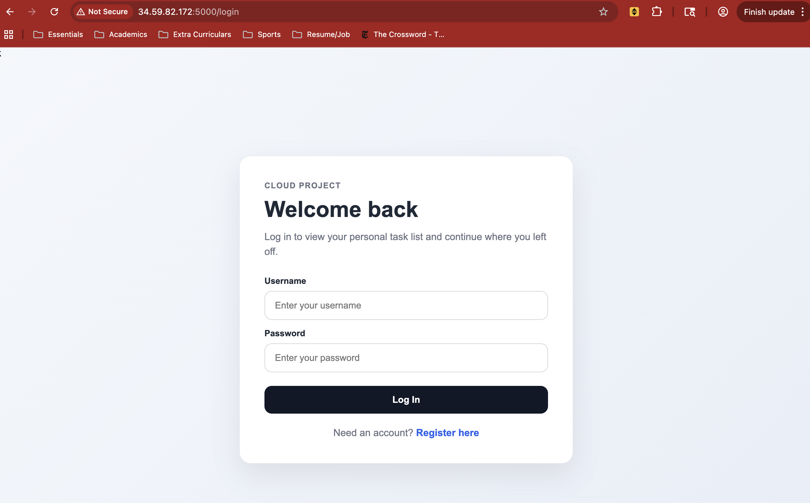
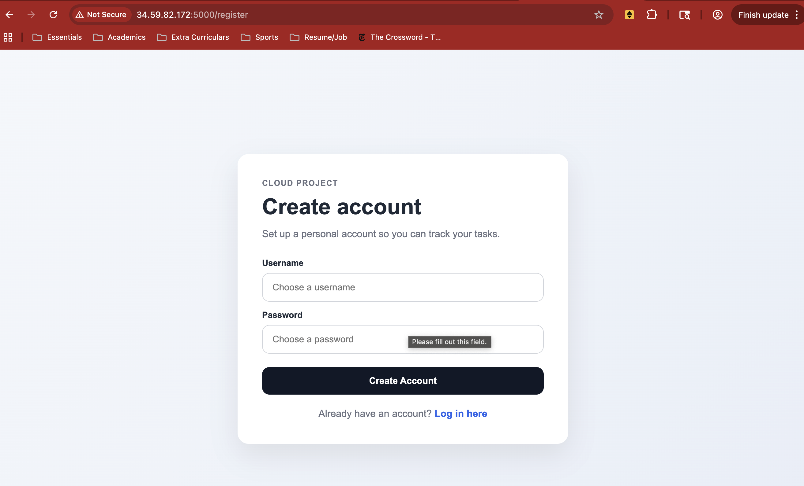
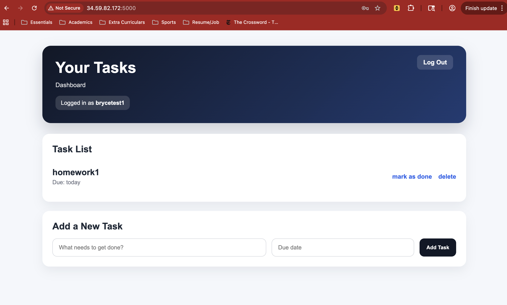
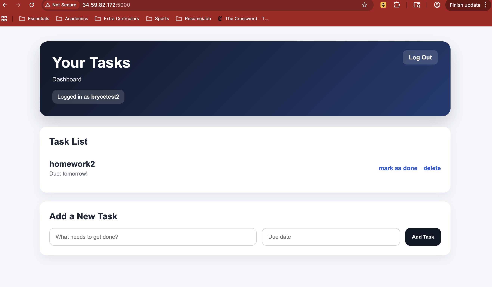

# Cloud Native To-Do App

A multi-user To-Do application built with Flask, SQLite, Docker, and Google Cloud. The project separates the frontend from the backend API, allowing each component to run independently.

The application supports user registration, login, and task management. The frontend was containerized with Docker and deployed through Google Kubernetes Engine (GKE), while the backend API ran on a separate Google Cloud virtual machine.

## Features

- User registration and login with hashed passwords
- Individual task lists for registered users
- Add, complete, and delete tasks
- Session-based login tracking
- Separate frontend and backend services
- Docker containerization and Kubernetes deployment

## Architecture

The application uses a split frontend and backend architecture.

- **Frontend:** Flask application in `todolist.py`
- **Backend API:** Flask REST API in `todolist_api.py`
- **Database:** SQLite database in `todolist.db`
- **Containerization:** Docker
- **Frontend hosting:** Google Kubernetes Engine (GKE)
- **Backend hosting:** Google Cloud VM

### How It Works

1. The user interacts with the Flask frontend through a browser.
2. The frontend handles login, registration, page rendering, and session tracking.
3. The frontend communicates with the backend through HTTP requests.
4. The backend processes account and task requests.
5. SQLite stores user accounts and their associated tasks.

Passwords are hashed before being stored in the database. Each task is associated with a user ID.


## Screenshots

### Cloud login page


### Cloud register page


### Cloud user 1 dashboard


### Cloud user 2 dashboard



## Project Structure

```text
final_project/
├── Dockerfile
├── README.md
├── cleanup.sh
├── init_db.py
├── startup.sh
├── test.sh
├── todolist.py
├── todolist_api.py
├── todolist.db
└── templates/
    ├── index.html
    ├── login.html
    └── register.html
```

## Deployment

The project includes scripts for deploying the frontend through Docker and Kubernetes and running the backend on a Google Cloud VM.

The deployment scripts reflect the original cloud configuration. Review the resource settings, firewall rules, and associated costs before running them again.
